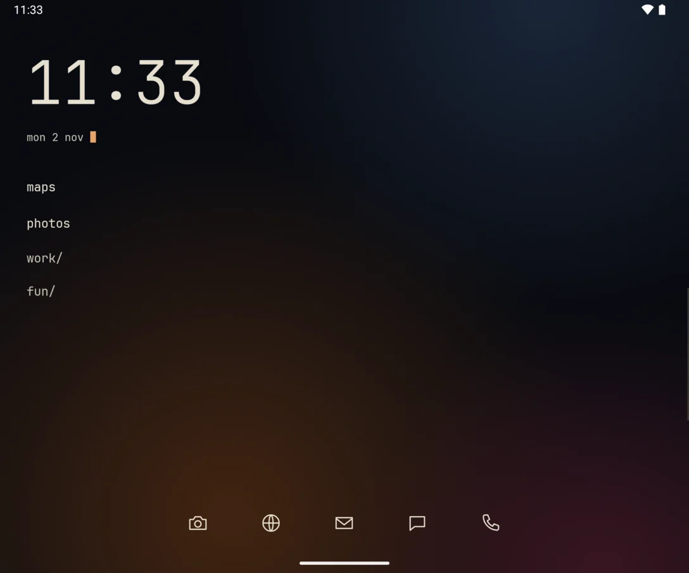
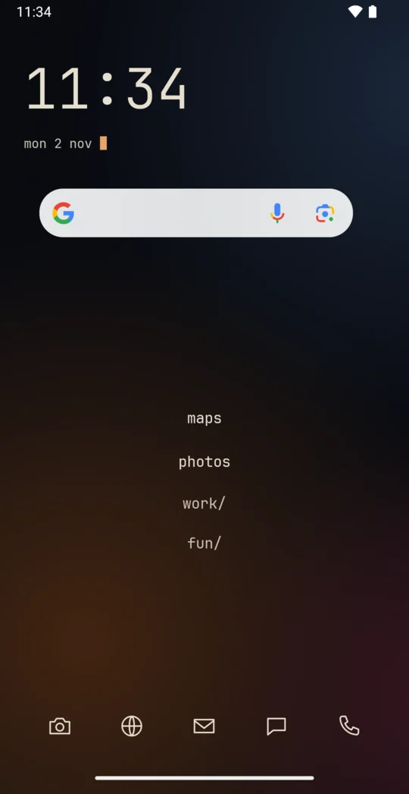
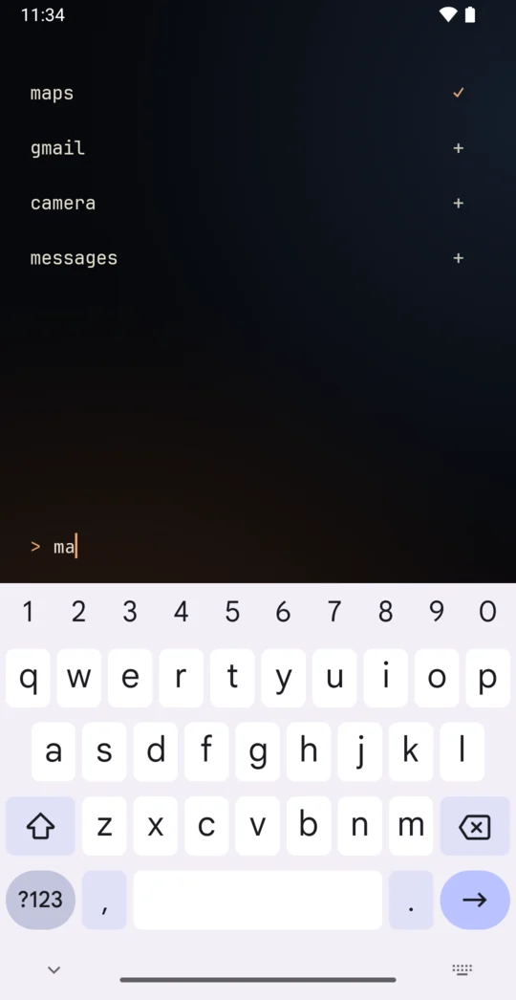
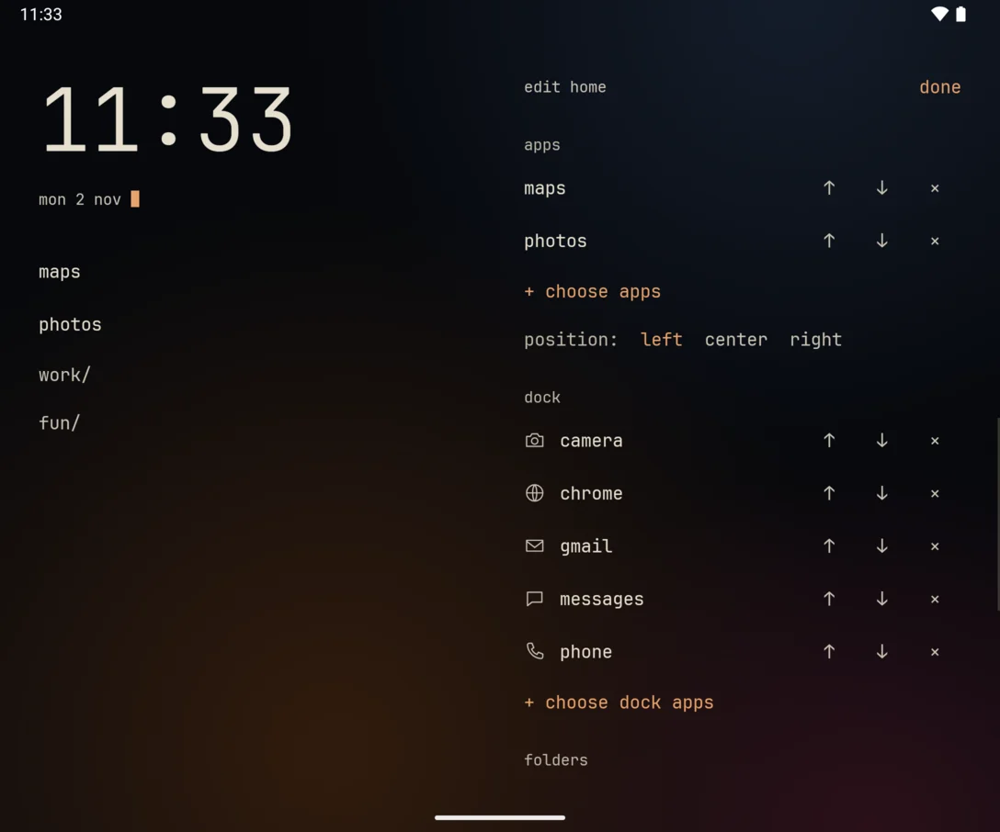
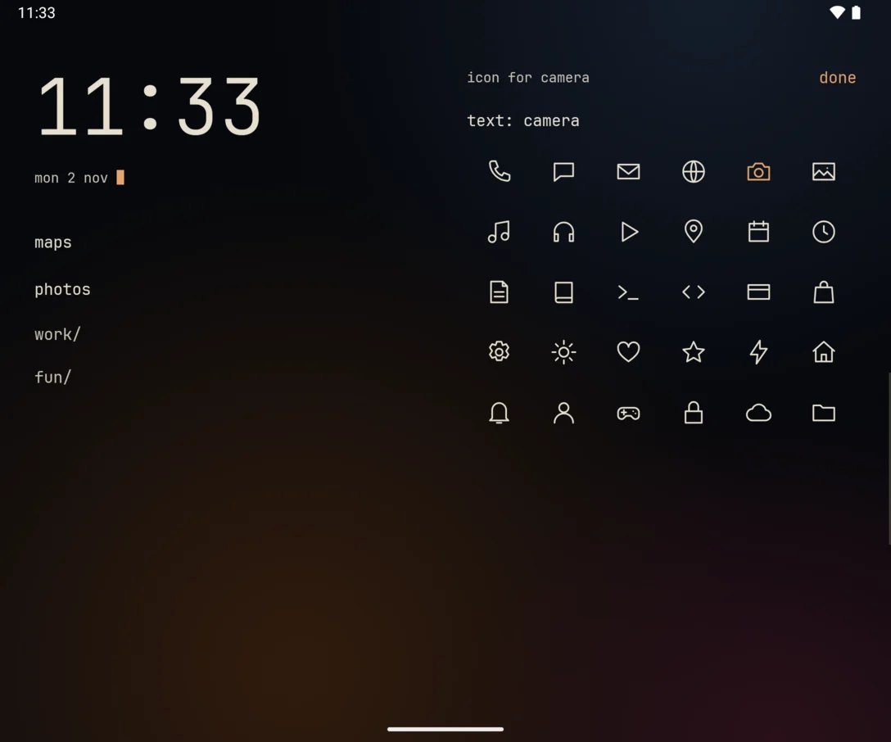
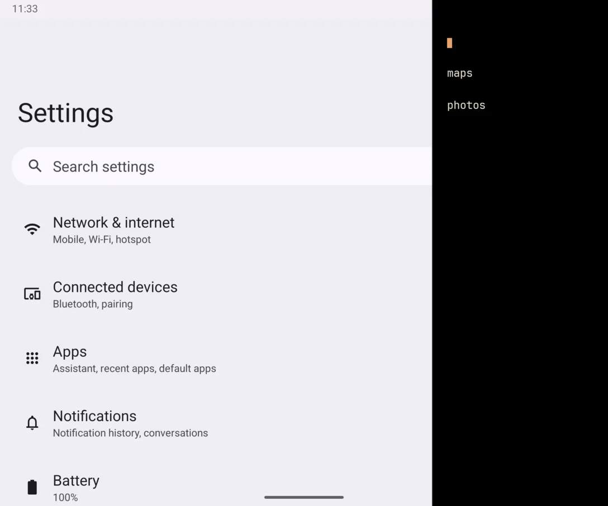
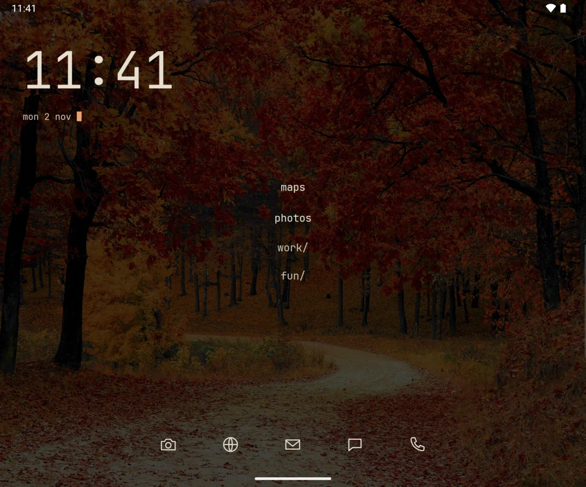

# crease

A text-only terminal launcher for foldable Android phones, in the spirit of Pro Launcher.
Android 11+. No icons, no internet permission, under 1 MB.

  
  
  

  
  
  

  

Screenshots are from a foldable emulator.

## Install

Download [`crease.apk`](https://github.com/JonathanRiche/crease/releases/latest/download/crease.apk)
on the phone and open it, or build it yourself:

    ./gradlew assembleRelease
    adb install app/build/outputs/apk/release/app-release.apk

Then pick crease as the home app in
Settings > Apps > Default apps > Home app. To go back, choose your old launcher there,
or run `settings` in crease.

## Using it

- **Home** shows only the apps and folders you choose, plus your widgets.
- **Swipe up** for search. It lists every app, and `+` puts one on home. It also runs commands.
- **Hold the clock or an empty area** to edit: choose and order apps, set up the dock, manage folders and widgets, pick a colour and a background.
- **The dock** sits at the bottom. Any app can go in it, showing a line icon you pick or its name. Add apps in edit mode, and tap one there to change its icon.
- **Swipe in from the right edge** on the inner screen, inside any app, for a text panel of your apps and recents. Turn it on and choose its apps in edit mode. It uses an accessibility service with no access to screen content.
- **Hold an app** for its shortcuts, rename, hide, app info and uninstall.

On the inner screen, home apps can sit on the left, in the center or on the right (set in edit mode), and the dock is centered. Widgets stay on the right half.
**Hold a widget** to stretch it: drag its right or bottom edge. Widgets belong to the screen you add them on, so each screen keeps its own set.

## Commands

Type these in search. Tap any listed name to run it. Output clears when you go home. Typing shows live suggestions above the prompt.

| Command | What it does |
| --- | --- |
| `<app>` | Opens the best match. Several equal matches are listed instead. |
| `ls [folder]` | Lists folders and unfiled apps, or one folder |
| `folder new\|rm <name>` | Creates or removes a folder. Apps stay installed. |
| `folder add\|del <name> <app>` | Puts an app in a folder or takes it out |
| `pin\|unpin <app>` | Adds or removes an app in the shortcut row |
| `alias <name> <app>`, `unalias <name>` | Short names |
| `hide <app>`, `unhide [app]` | Hides apps from lists |
| `widget add [search]` | Lists widgets to add to this screen |
| `widget ls`, `widget rm <n>`, `widget size <n> <dp>` | Manages this screen's widgets |
| `web <query>` | Searches DuckDuckGo in your browser |
| `info\|uninstall <app>` | Opens app info or the uninstall dialog |
| `settings`, `clear` | Opens system settings; clears the output |
| `theme [name]`, `keyboard on\|off` | Accent colour; opens search whenever you go home |

Commands win over app names. To open an app called `Settings`, use `open settings`.

## Development

Needs JDK 17 and the Android SDK (API 36). `./gradlew testDebugUnitTest` runs the command logic tests.
`Shell.kt` holds that logic and has no Android imports; `MainActivity.kt` is the UI and widget host.

## Credits

The look and the dock are inspired by [Detent](https://github.com/bjarneo/detent), whose keyword list for suggesting icons is adapted here (MIT). Uses JetBrains Mono under the SIL Open Font License (`licenses/JetBrainsMono-OFL.txt`).
